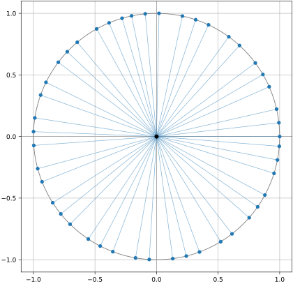

+++
title = "Worked Example of OpenAI's Unit Distance Construction"
date = "2026-10-31T08:48:52Z"
draft = false

#
# worked example or openai's unit distance construction on a single fixed example
#
# description = "worked example or openai's unit distance construction on a single fixed example"

tags = ["unit distance",]
+++

This will be a single fixed-field example to hopefully aid in understanding the famous OpenAI counterexample disproving Paul Erdős's conjectured lower bound for the number of unit distances determined by a point set in the plain. I am working from [the human write-up](https://arxiv.org/abs/2605.20695), not the original paper. This example very much does not provide a sequence with $f$ tending to infinity and as such does not prove Theorem 1.1.

It will also be very dry reading... oh well-- look at the graph!



*^unit distances given by ratios of ideals about the origin (ooh neat)*


## First Quantities and Set-up

For the fixed field $K=\mathbb Q(i)$ and single rational prime $p=5$:
$$
\mathcal O_K=\mathbb Z[i],\quad [K:\mathbb Q]=2,\quad f=1,
\quad \operatorname{Disc}K=-4,\quad h(K)=1.
$$

Using $\lbrace 1,i \rbrace$ as our basis, we have
$$
\operatorname{Disc}K
=\det
\begin{pmatrix}
1 & i \cr
1 & -i
\end{pmatrix}^2
=(-2i)^2=-4.
$$

The class number is $1$ as in the Gaussian integers every ideal is principal.

The two complex embeddings are identity and (normal complex) conjugation. As we project to one of these in Lemma 2.1 we can just think of $K$ as $K$ under the identity embedding throughout.

The prime ideals that lie above $p$ are
$$
\quad P=(2+i),\quad\overline{P}=(2-i).
$$

Both have (field) norm of $5$ and ramification index $1$. They are one conjugate pair, so $s$ is $1$.

Following the choice of $k$ from the proof of Theorem 1.1
$$
k=\left\lceil\frac{18\cdot2^3}{\pi}\right\rceil-1
=\left\lceil\frac{144}{\pi}\right\rceil-1=45.
$$

Consequently
$$
Q=(P\overline{P})^{45}=(5^{45}),\text{ with }
Q^{-2}=5^{-90}\mathbb Z[i].
$$

Lemma 2.2's denominator formula gives
$$
D=5^{\lceil 2\cdot45/1\rceil}=5^{90}
$$
... so quite a lot of points!

## Construction of Nice Ideals

For $j=0,\ldots,45$ construct the nice ideals
$$
I_j=P^j\overline{P}^{45-j}
=\big((2+i)^j(2-i)^{45-j}\big).
$$

All are in the same ideal class, thus taking $I_0=(2-i)^{45}$ as the reference ideal, gives $I_jI_0^{-1}=(\alpha_j)$, with

$$
\alpha_1=\frac{2+i}{2-i}=\frac{3+4i}{5},\text{and } \alpha_j=\alpha_1^j.
$$

Since $\alpha_1$ times its complex conjugate is $1$, $\alpha_j$ times its conjugate is also $1$. The $u$'s are then
$$
u_j=\frac{\alpha_j}{\overline{\alpha_j}}
=\alpha_1^{2j}=\left(\frac{-7+24i}{25}\right)^j,
\qquad 0\leq j\leq45.
$$

*^It might take a second to see that the $\alpha_1$ trickery works. Keep in mind also this is only possible as all ideals are principle in $\mathbb Z[i]$.*

The first few values we get are $1$, $(-7+24i)/25$, $(-527-336i)/625$, $(11753-10296i)/15625$. Each has absolute value $1$, denominator dividing $5^{90}$, they are distinct as the ideal of $\alpha_1$ has exponent $+1$ of the prime ideal $P$ and $-1$ for its conjugate, so the powers of $\alpha_1$ will never "loop back around". Lemma 2.2 therefore gives at least $46$ distinct unit distance pairs
$$
|U|\geq \frac{(45+1)^1}{1}.
$$

## Applying the First Lemma

The lattice is the ordinary planar square grid

$$
\Lambda=\Phi(D^{-1}\mathcal O_K)
=\left\lbrace\frac{x+iy}{5^{90}}: x,y\in\mathbb Z\right\rbrace.
$$

Recall the sole coordinate projection is the identity. We calculate our quantities as
$$
\delta=D^{-1}=5^{-90},\qquad \operatorname{covol}(\Lambda)=2^{-f}\delta^{2f}\sqrt{|\operatorname{Disc}K|}=5^{-180},\qquad
v=\delta^{-2}\operatorname{covol}(\Lambda)=1.
$$
*^I think this illustrates the point I was trying to make in class about what $v$ "means" intuitively.*

The lower-bound on "unit-distances per dimension" should be
$$
u=(k+1)r^{-2}=46/4=23/2=11.5,
$$
with $r$ denoting the root discriminant (as in the paper). This is essentially because we have that
$$
|U_{\Lambda}|\geq |U|\geq \frac{(45+1)^1}{1}\geq\left(\frac{k+1}{r^2}\right)^f.
$$
But the class-number bound cited in the paper ($h(K)\leq |\operatorname{Disc}K|=r^2$) is only for $K$ of degree at least $4$ over $\mathbb Q$. Fortunately we have $h(\mathbb Q(i))=1\leq4$ directly. This is really just one of many ways this is really a bit of a fudge.

None the less, we do get that
$$
u=11.5>36/\pi=36v/\pi,
$$
as required.

Taking $R=2$, Lemma 2.1 yields
$$
|P|\leq\left(\frac{9R^2}{\delta^2}\right)^f=36\cdot5^{180}\approx2.349109608479469\times10^{127},
$$
and
$$
2\nu(P)\geq\left(\frac{u\pi R^2}{4v\delta^2}\right)^f=\frac{23\pi}{2}\cdot5^{180}
\approx2.357482586596594\times10^{127}.
$$

So the exponent is
$$
\frac{\log(2\nu(P))}{\log|P|}
\geq1+\frac{\log(23\pi/72)}{\log(36\cdot5^{180})}
\approx1.0000121315955266
\ggg 1+6.24\cdot10^{-38},
$$
with the last value being the asymptotic bound achieved in the paper using class-field tower.

## Note about the Plot

Plotting every unit distance for the entire box $R=2$ is infeasible as the lattice is extremely fine. Instead each of the 46's distinct vectors is show just once, the construction does however include all the translates. Done in Matplotlib with help of the AI, and using the $\alpha_1$ powers trick from before:

```python
us = []
a, b, d = 1, 0, 1

for _ in range(46):
    us.append((a / d, b / d))
    a, b = -7 * a - 24 * b, 24 * a - 7 * b
    d *= 25

fig, ax = plt.subplots(figsize=(6, 6))

ax.add_patch(Circle((0, 0), 1, fill=False, color="0.5", linewidth=0.9))
ax.axhline(0, color="0.5", linewidth=0.7)
ax.axvline(0, color="0.5", linewidth=0.7)

for x, y in us:
    ax.plot([0, x], [0, y], color="C0", linewidth=0.7, alpha=0.55)

x, y = zip(*us)
ax.scatter(x, y, color="C0", s=18, zorder=3)
ax.scatter([0], [0], color="black", s=24, zorder=4)

ticks = [-1, -0.5, 0, 0.5, 1]
ax.set(aspect="equal", xlim=(-1.1, 1.1), ylim=(-1.1, 1.1),
       xticks=ticks, yticks=ticks)
ax.grid(True, linewidth=0.6)
```

*^code used in plot at top of post*

Thanks to everyone from the unit distance sum product reading group at the University of Bristol for which this was written. More to come!
