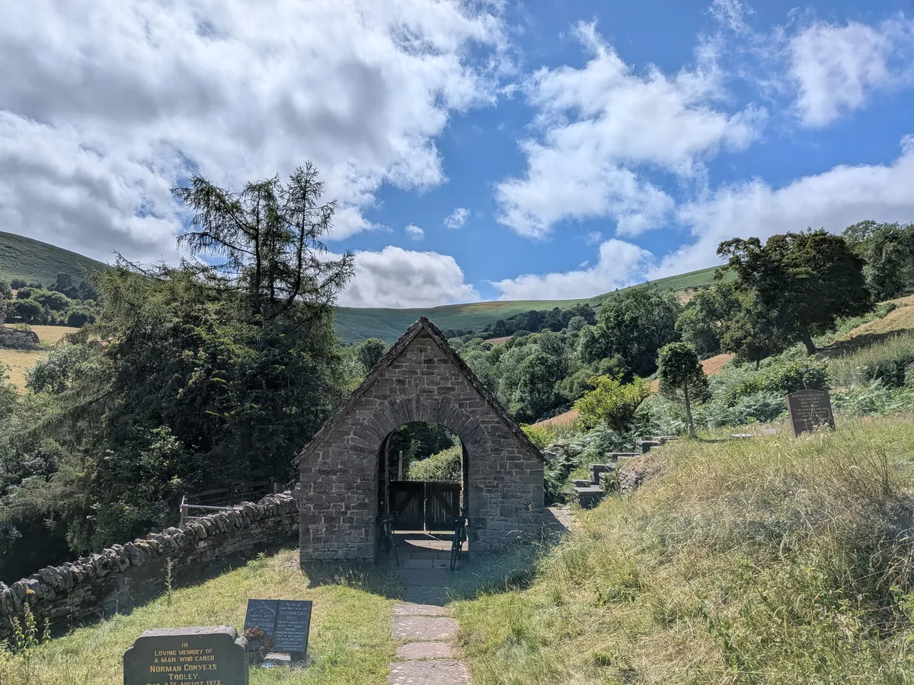

+++
title = "WOMBL 18 - day 3"
date = "2026-07-01T16:53:59+01:00"
draft = false

#
# personal blogpost about the wombl residential 2026
#
# description = "personal blogpost about the wombl residential 2026"

tags = ["wombl18"]
+++

We had only one talk on this our final day in  Ambleside. It was given by Leonardo Franchi on his [A strengthening of Chang's lemma](https://arxiv.org/abs/2605.07916). I think this was my favourite talk of the weekend-- it was a very neat result and well motivated.

It was also in going over my notes from the talk that I first thought seriously about Chang's lemma etc. in the setting of finite fields-- an area that I can now see is a clear weakness of mine.

## So Was It A Good Idea To Attend A Conference So Early?

I think this is really a question worth asking. Being the least knowledgeable person in the room-- as it were-- was certainly a rather stressful experience; but I don't think I was at any time so out of my depth as to not understand at all what any of the speakers were saying. Nor do I think my confidence took any significant blow.

My attention had been turned more to my weaknesses, but I think this is in keeping with the correct rhythm: having made a first move out in to a new field and having gained some self belief it is time to step back and appreciate quite how much I have still to learn.

And this is the main benifit I have gained: each talk and each conversation gave me something to read up on. I am writing this a few days after leaving Ambleside, having left Bristol again. This time I am in my uncle's cottage in Wales for a "reading holiday", using the quiet and seclusion to do some focused work on Freiman's theorem, Chang's lemma and some general group theory.

*^church at Partrishow one valley over from were we're staying*

The papers on Freiman's theorem are quite accessible and I am making quick headway. The stuff on Chang's lemma however shows that there is quite a lot of background that I am missing. I do feel productive at least in making more work for my future self to do.

Thanks to everyone who attended WOMBL and to Misha for getting me invited.

More to come...
